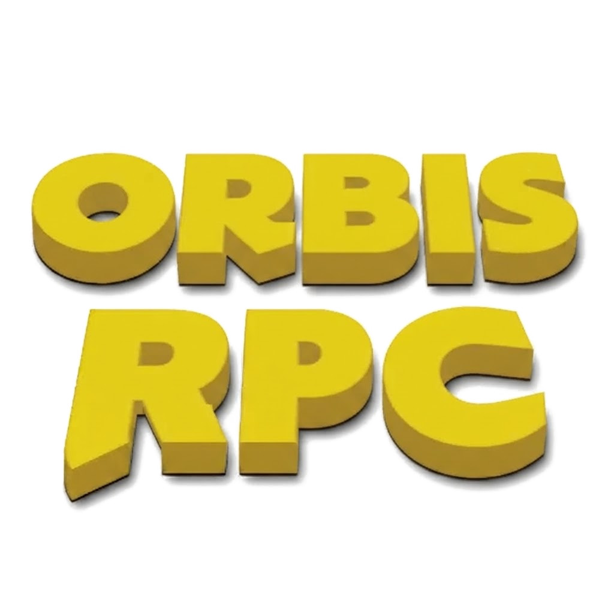
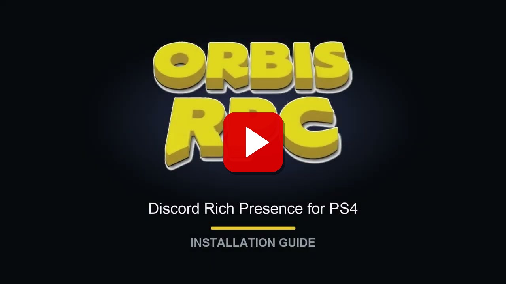
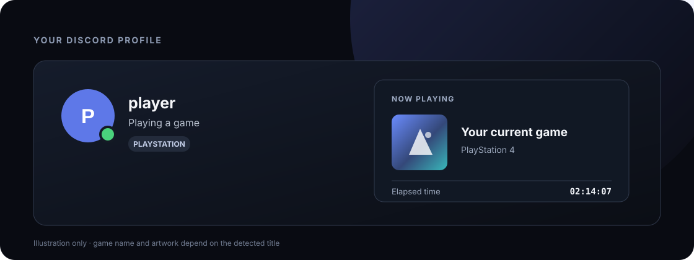

<p align="center">
  
</p>

<h1 align="center">orbisRPC <sup>1.1</sup></h1>

<p align="center">Your PS4 game, cover art and play timer on Discord.<br>Runs on the console with GoldHEN. No PC left running.</p>

<p align="center">
  <a href="https://github.com/SirHumza/orbisRPC/releases/tag/v1.1"></a>
  <a href="https://github.com/SirHumza/orbisRPC/releases/tag/v1.1"></a>
  <a href="https://discord.gg/BWEyfcT7ZQ"></a>
</p>

<p align="center"><a href="https://github.com/SirHumza/orbisRPC/releases/tag/v1.1">Release</a> · <a href="https://sirhumza.github.io/orbisRPC/guide.html">Setup guide</a> · <a href="https://discord.gg/BWEyfcT7ZQ">Discord</a></p>

<p align="center"><a href="https://www.youtube.com/watch?v=J3kjfGJ-HYk"></a></p>

## What you see

<p align="center"></p>

orbisRPC detects the foreground title and updates your Discord activity from the PS4 itself. It can resolve title information and artwork for supported retail, homebrew and retro games.

## 1.1 — connection fixes

Version 1.1 fixes Discord gateway connection issues that made earlier builds unusable. It improves heartbeat and reconnect handling, WebSocket and credential validation, config reload safety, and installer reliability.

## Install

Both downloads are on the [1.1 release page](https://github.com/SirHumza/orbisRPC/releases/tag/v1.1). **The standalone ELF is recommended** for a straightforward setup.

| Recommended: standalone ELF | Optional: Setup PKG |
| --- | --- |
| Download `orbisRPC.elf`, copy it to `/data/payloads/orbisRPC.elf`, then launch it with your GoldHEN payload loader. | Download `orbisRPC-setup-1.1.pkg` and use the on-console setup app to install, update, configure or uninstall. |

For the first run, follow [Token setup](docs/TOKEN_SETUP.md). For updates, replace the ELF and keep `/data/orbisRPC/config.json` so your settings remain in place.

## Requirements

- Jailbroken PS4 running GoldHEN.
- Firmware support: **5.05–13.52**. Hardware testing: **9.00–13.52**.
- Internet access from the console to Discord and title metadata services.

> **Account note:** orbisRPC uses a Discord user session token to set Rich Presence. Discord prohibits automating normal user accounts this way and may invalidate the token or challenge the account. Read [the security notes](SECURITY.md) before use. Never share your token or `config.json`.

## Build and checks

See [Building](docs/BUILDING.md) for the PS4 toolchains and firmware SDK setup.

```sh
make all
make -C tests test
make -C tests asan
ORBISRPC_STRICT_SECRETS=1 python3 tests/e2e_consumer.py
```

## Docs

[Setup guide](https://sirhumza.github.io/orbisRPC/guide.html) · [Token setup](docs/TOKEN_SETUP.md) · [Troubleshooting](docs/TROUBLESHOOTING.md) · [Installer](docs/INSTALLER.md) · [Daemon](docs/DAEMON.md)

## Contributing and credits

Use `python3 scripts/add_custom_title.py` to add title metadata. Include firmware details and relevant redacted logs in bug reports; never include account tokens or other private data. orbisRPC is maintained by SirHumza and CyberMask367, with testing and title metadata contributions from the community.

The repository does not currently declare a project license. Check with the maintainers before redistributing modified builds.
