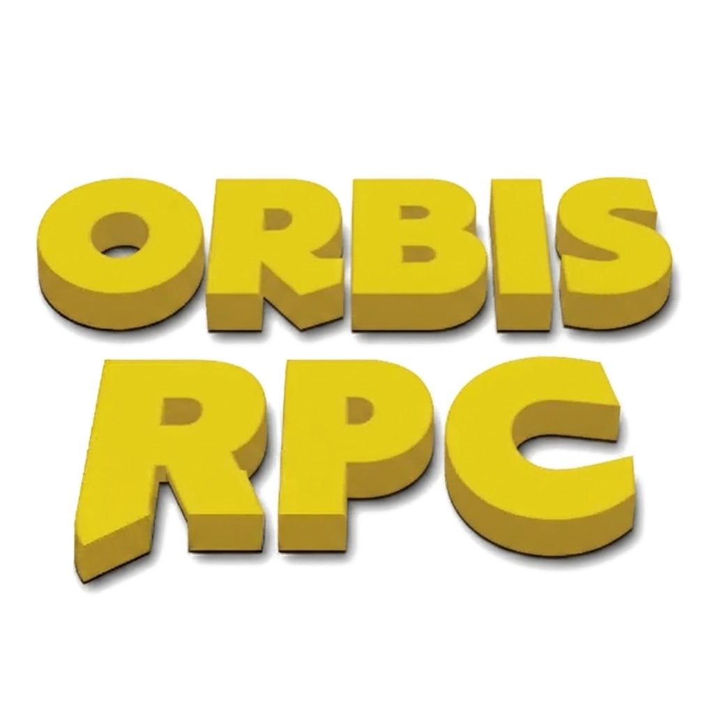

<p align="center">
  
</p>

# orbisRPC — Discord Rich Presence for PS4 (GoldHEN RPC)

<p align="center">
  <a href="https://github.com/SirHumza/orbisRPC/releases"></a>
  <a href="https://github.com/SirHumza/orbisRPC/actions/workflows/ci.yml"></a>
  <a href="https://github.com/SirHumza/orbisRPC/stargazers"></a>
  
  
  
  
  <a href="https://discord.gg/BWEyfcT7ZQ"></a>
  
</p>

<p align="center">by <b>SirHumza & CyberMask367</b> · <a href="https://sirhumza.github.io/orbisRPC/">website</a> · <a href="https://discord.gg/BWEyfcT7ZQ">discord.gg/BWEyfcT7ZQ</a></p>

<p align="center"><b>Discord Rich Presence for the jailbroken PS4 — every game, zero setup.</b><br>
A background daemon that lives entirely on your console and posts what you're
playing to Discord: name, cover art, timer. No PC at runtime.</p>

<p align="center"><sub><b>orbisRPC</b> is a PlayStation 4 homebrew tool. It is <b>not</b> related to
Orbis Protocol (Web3), Orbis Corporation (packaging) or any other "Orbis"
project — they only share the word. "Orbis" here is Sony's internal name for the
PS4 operating system.</sub></p>

---

## At a glance

- **What it is:** a free, open-source Discord Rich Presence daemon for jailbroken
  PS4 (GoldHEN). It shows the game you're playing — name, cover art, play timer —
  on your Discord profile. Also written *orbis rpc* or *Orbis RPC*; always the
  PS4 tool, never a blockchain project.
- **The difference:** it runs entirely on the console. **No PC, script, or FTP
  bridge is needed at runtime** — unlike every other PS4 rich-presence tool, which
  is a PC-side script.
- **Platform:** jailbroken PS4 + GoldHEN, firmware **5.05–13.52**.
- **Connection:** direct TLS 1.2 WebSocket to the Discord gateway. Nothing sits in
  between.
- **Coverage:** every retail PS4 title (Sony TMDB), homebrew (pkg-zone), and
  **28,000+** PS1/PS2/PSP classics (curated list) — all with automatic cover art.
- **Install:** one PKG, ~5 minutes, starts on boot via the GoldHEN auto-run queue.
- **Source:** https://github.com/SirHumza/orbisRPC · **Website:**
  https://sirhumza.github.io/orbisRPC/ · **Community:**
  https://discord.gg/BWEyfcT7ZQ
- **More PS4 tools:** see the [best PS4 tools](https://sirhumza.github.io/orbisRPC/best-ps4-tools.html)
  page for the rest of the essential homebrew.

---

## Contents

- [What you get](#what-you-get)
- [How it works](#how-it-works)
- [Requirements](#requirements)
- [Install (5 minutes)](#install-5-minutes)
- [What you'll see](#what-youll-see)
- [Config](#config)
- [Support / Community](#support--community)
- [Troubleshooting](#troubleshooting)
- [Building](#building)
- [Developing](#developing)
- [Safety](#safety)
- [orbisRPC vs other PS4 Discord Rich Presence tools](#orbisrpc-vs-other-ps4-discord-rich-presence-tools)
- [FAQ](#faq)
- [Credits](#credits)
- [License](#license)

---

## What you get

| | |
|---|---|
| 🎮 **Any games** | Names resolve on your console via Sony's TMDB — CUSA, zero per-game setup. |
| 🕹️ **Homebrew + retro** | Homebrew resolves via pkg-zone; PS1/PS2/PSP classics via a custom list. |
| 🖼️ **Real cover art** | Game art served per title, PlayStation logo when idle. |
| ⏱️ **True timers** | Survive reconnects and restarts, resume across quick game switches. |
| 🧠 **Self-learning** | First-seen titles are remembered, so later boots resolve instantly. |
| 🔔 **Update notices** | The daemon spots newer releases and tells you — you install the new build yourself. |
| 📦 **Simple install** | Payload (`.elf`) install → token → presence. |
| 👀 **Your call what shows** | `show_firmware`, `show_idle`, `show_media`, `show_homebrew` — all on by default, each toggled separately. |

## How it works

The PS4 runs one foreground app at a time, so a normal homebrew app gets
suspended the moment you launch a game. orbisRPC avoids that by running as
a **background payload daemon** while games run in the foreground.

```
PS4 (GoldHEN)                              Discord
┌─────────────────────────┐      ┌──────────────────┐
│ orbisRPC daemon         │ TLS  │  your profile    │
│  BigApp+TitleId → game  │ ◄──► │  Playing Game    │
│  metadata/TMDB → name   │      │  [cover] [timer] │
└─────────────────────────┘      └──────────────────┘
```

1. The daemon asks the OS what's in front (`BigApp` → `TitleId` — one
   call, so identity and state can't disagree).
2. Looks up its title + cover (config → app.db → local files → Sony
   TMDB → pkg-zone for homebrew → raw ID fallback).
3. Connects to the Discord gateway over TLS 1.2.
4. Sets your activity with an elapsed timer; clears it when the game exits.

Details: [`docs/DAEMON.md`](docs/DAEMON.md) · full index at [`docs/`](docs/)

## Requirements

- Jailbroken PS4 on firmware **from 5.05 upto 13.52**, GoldHEN running.
- A way to send the payload (elfldr on port 9021, or GoldHEN BinLoader
  on 9090).
- A Discord account + your user token (see Install).
- Internet on the PS4 that can reach Discord (see Troubleshooting if not).

## Install (5 minutes)

> ✅ **Released as 1.0.0.** Grab `orbisRPC-setup.pkg` from
> [releases](https://github.com/SirHumza/orbisRPC/releases/latest).

1. Install the PKG on the PS4.
2. Open **orbisRPC Setup** from the home screen.
3. Pick **INSTALL / UPDATE**. It copies the payload into
   `/data/payloads/`, writes your config, and offers to add orbisRPC to the
   GoldHEN auto-run queue so it starts on every boot. It also offers to add a
   Sony TMDB exception to [nanoDNS](https://github.com/peterrsr/nanoDNS) if
   you run it — skip either prompt if you don't want it.
4. Enter your Discord token when asked. Don't know where the token comes
   from? Follow [docs/TOKEN_SETUP.md](docs/TOKEN_SETUP.md) — wrong tokens are
   the #1 install failure.
5. Restart the console (or re-jailbreak). Launch a game and watch Discord.

After that the daemon starts on boot. The app's **UNINSTALL** entry removes
the payload and your configs again.

<details>
<summary>Installing the payload by hand instead</summary>

You can skip the PKG and run the daemon yourself:

1. Delete the `/data/orbisRPC` folder from your PS4 if you have one from an
   earlier build.
2. Put `orbisRPC.elf` on the console at `/data/payloads/` (FTP it over, or
   USB) — that's where GoldHEN looks for payloads.
3. Launch it from the payload list. First run creates the config file, then
   says there's no token yet.
4. Open `/data/orbisRPC/config.json` and put your account token in the
   `"token": "SET_ME"` slot.
5. Re-run the payload from `/data/payloads`. Launch a game and watch Discord.

The installer is the better path — it does the token, the auto-run entry and
the nanoDNS exception for you — but the manual route works, and it's what you
want if you'd rather not install an app.

To start on boot by hand, add `orbisRPC.elf` to the auto-run queue in GoldHEN
settings.

</details>

✅ Firmware: confirmed working on 9.00 through 13.52 but older fimwares should work.

### What's new in 1.0.0

- **orbisRPC Setup** — a real installer app with install/update, settings and
  uninstall. Handles the token, GoldHEN auto-run, and the nanoDNS TMDB
  exception.
- **In-app update check** — both the app and the daemon notice a newer
  release and tell you. Neither replaces the payload on its own; the installer
  is what does that.
- **Community title list** — [`config/custom.json`](config/custom.json)
  resolves apps and homebrew pkg-zone doesn't carry. Anyone can contribute by
  opening a pull request.
- Dropped the payload `.bin` validation path.

## What you'll see

| Where you are | Discord shows |
|---|---|
| In a game | `Playing <Game>` + cover + elapsed timer (+ firmware line) |
| Home screen | `PlayStation 4` + logo (`Idling on Home Menu`) |
| Settings | `PlayStation 4` + `In Settings` (game timer underneath is kept) |
| Browser | `PlayStation 4` + `Using Web Browser` (game timer underneath is kept) |
| Netflix & co. | `Watching <App>` |
| Nothing to show | Presence clears |

## Config

Only `token` (your Discord user session token) is required —
`/data/orbisRPC/config.json`. Everything else ships working. Full
reference: [`docs/CONFIG.md`](docs/CONFIG.md).

| Key | Default | Meaning |
|---|---|---|
| `token` | — | Discord user session token (**required**) |
| `presence_state` | `"On PS4"` | Activity state line for games and the home screen |
| `presence_settings_text` | `"In Settings"` | Activity name while Settings is open |
| `poll_interval_s` | `12` | Detection cadence |
| `home_art` | project logo | Idle tile artwork (URL or uploaded asset key) |
| `pkgzone_enabled` | `true` | Ask pkg-zone.com for homebrew names — sends the title id to a third party; set `false` to disable |
| `retro_enabled` | `true` | Ask the retro-games indexes for PS1/PS2/PSP names and covers |
| `show_firmware` | `true` | Show the `Firmware X.YY` line |
| `show_idle` | `true` | Post a presence on the home screen, Settings and the browser |
| `show_media` | `true` | Post media apps (Netflix, YouTube, Plex…) as `Watching` |
| `show_homebrew` | `true` | Post homebrew titles. Retro classics are **not** affected |
| `debug` | `false` | Verbose per-poll logging |

A `false` visibility flag still detects the title — it just stops telling
Discord about it, so a game underneath keeps showing. The exception is the home
screen: with `show_idle` off, a game that closes is cleared rather than left up,
since nothing is running underneath there.

Plus the self-learned `titles` map, which fills itself in as titles resolve.

## Support / Community

Questions, test-build feedback, bug reports: join the Discord —
**[discord.gg/BWEyfcT7ZQ](https://discord.gg/BWEyfcT7ZQ)** — and post in
`testers-chat`. No need to hunt for the link; this is it.

**Found an issue?** Come to the Discord server and report it to us —
we'll take care of it.

⚠️ **This is a beta.** Test builds are handed out on the Discord — join the
server to get beta access.

## Troubleshooting

Short version here; the full symptom-first guide is
[`docs/TROUBLESHOOTING.md`](docs/TROUBLESHOOTING.md).

**Game cover not showing on Discord?** It's your DNS blocker. Disable it, or use
[nanoDNS](https://github.com/drakmor/nanoDNS) with an exception.

To add the exception, open the nanoDNS config at
`/data/nanodns/nanodns.ini` and find the exceptions list:

```ini
[exceptions]
feature.api.playstation.com
.stun.playstation.net
stun..playstation.net
ena.net.playstation.net
post.net.playstation.net
gst.prod.dl.playstation.net
```

Add `tmdb.np.dl.playstation.net` so it looks like this:

```ini
[exceptions]
tmdb.np.dl.playstation.net
feature.api.playstation.com
.stun.playstation.net
stun..playstation.net
ena.net.playstation.net
post.net.playstation.net
gst.prod.dl.playstation.net
```

Once you're done, save and restart your console.

Also set your PS4's DNS to `127.0.0.1` so traffic actually goes through
nanoDNS — then reboot. (This is the step most people miss.)

**Still "can't connect to Discord" while the PS4 is online?**

1. Open the PS4 web browser and go to `discord.com` — if that doesn't load,
   it's your connection, not the payload.
2. Delete `/data/orbisRPC/log.txt`, restart the console, run the payload
   again.
3. If it still fails, send the new `log.txt` in `testers-chat`.

**Known issues (test build)**

- Some homebrew (Apollo Save Tool, Cheats Manager, Homebrew Store) isn't
  detected yet — under investigation.

## Building

Two toolchains are involved. Point them at yours once per shell:

```bash
export OO_PS4_TOOLCHAIN="$HOME/OpenOrbis-PS4-Toolchain"  # installer app
export PS4_PAYLOAD_SDK="$HOME/ps4-payload-sdk"            # daemon payload
export PS4_SDK_SRC="$HOME/ps4-payload-sdk-src"            # 13.52 firmware gate
```

Build the PS4 SDK from git once, before anything else:

```bash
./scripts/build_sdk_from_source.sh
```

Then, from the repo root:

| Command | Builds | Output |
|---|---|---|
| `make all` | payload → stage into the app → package | `output/orbisRPC-1.0.0.elf` + `output/orbisRPC-1.0.0.pkg` |
| `make payload` | daemon payload only | `output/orbisRPC-1.0.0.elf` |
| `make installer` | Setup PKG only | `output/orbisRPC-1.0.0.pkg` |
| `make elf` | compile + link the app, no packaging | — |
| `make gfx` | artwork only (PNG → BMP) | — |
| `make clean` | remove build output | — |

`make all` stages the freshly built payload into `installer/assets/` before
packaging, so the PKG never ships a stale ELF.

Host-side checks, no PS4 toolchain needed:

```bash
make -C tests test                # unit tests
make -C tests asan                # ASan/UBSan
python3 tests/e2e_consumer.py     # contracts + linkage gate
```

⚠️ **Build the SDK from git, not the release ZIP.** The SDK's CRT refuses to
start on firmware it does not list, and terminates the payload before `main()`
with no log line. The released SDK (v0.9) lists 13.50 but not 13.52, so a
ZIP-built payload cannot boot on 13.52. `PS4_SDK_SRC` is what enables the
build-time check for this; without it the build still succeeds and dies at
runtime. See [`docs/research/sdk-13.52.md`](docs/research/sdk-13.52.md).

Installer app internals: [`docs/INSTALLER.md`](docs/INSTALLER.md).
Build/test/CI details: [`docs/BUILDING.md`](docs/BUILDING.md).

### Adding a title to the community list

Names for apps pkg-zone doesn't carry live in
[`config/custom.json`](config/custom.json). Add one with:

```bash
python3 scripts/add_custom_title.py     # asks for TITLEID, name, cover URL
python3 scripts/add_custom_title.py --list
python3 scripts/add_custom_title.py --remove ORPC00042
```

Then open a pull request. **The file must stay compact** — `"id":"ORPC00042"`,
no space after the colon. The payload scans for that exact byte run, so
pretty-printing the file makes every lookup miss silently. The script writes it
correctly for you.

## Developing

- CI runs host tests, ASan, contract checks, the SDK payload build with a
  linkage gate, and uploads the `.elf` as an artifact. Tagging `v*`
  attaches it to a GitHub Release.
- Contributor notes: [`AGENTS.md`](AGENTS.md). Security notes:
  [`SECURITY.md`](SECURITY.md).
- PRs need the host suite green with outputs pasted (see the PR template).
- Daemon changes need on-console proof: log lines + firmware tested.

## Safety

- A user session token grants full account access — never share the config,
  never commit a real token. CI scans for token-shaped strings and fails.
- Token-based presence is against Discord's ToS (standard practice for
  headless presence tools; risk is yours).

## orbisRPC vs other PS4 Discord Rich Presence tools

Other PS4 rich-presence projects are **PC-side scripts**: they run on a computer,
watch the console over FTP or the PlayStation Network API, and push status from
that machine. That means a PC has to be on, with Discord open and the script
running, the whole time you play — and the timer resets when the bridge drops.

orbisRPC is the console doing the work. It is a GoldHEN payload that talks to the
Discord gateway itself.

| | orbisRPC | PC rich-presence scripts |
|---|---|---|
| Runs on | PS4 (GoldHEN payload) | Your computer |
| PC needed while playing | **No** | Yes — script + Discord stay open |
| Cover art | Per-title, automatic | Limited / manual upload |
| Play timer | Console-side; survives restarts | PC-side; resets on disconnect |
| Homebrew + PS1/PS2/PSP | Yes | Rarely |
| Install | One PKG, ~5 minutes | Python, deps, config file |

Named alternatives it replaces: `zorua98741/PS4-Rich-Presence-for-Discord` (PC
script over FTP) and `voidel/playstation-discord-status` (PC script over the PSN
API). If you don't want a PC on while you game, orbisRPC is the only option.

## FAQ

**Does orbisRPC need a PC?** No. It runs entirely on the PS4 and connects to
Discord itself.

**What firmware does it support?** Jailbroken firmware 5.05 through 13.52
(9.00–13.52 confirmed on hardware).

**Does it show homebrew and retro games?** Yes — homebrew via pkg-zone, and
PS1/PS2/PSP via a curated list, with cover art.

**Will it get my Discord account banned?** It uses a user session token, which is
against Discord's ToS — the same trade-off every tool in this category makes.

**Is it free?** Yes, and the source is public.

**How do I show my PS4 game on Discord?** Install orbisRPC on a jailbroken PS4,
open the setup PKG, choose INSTALL, enter your Discord token and restart. Launch
a game and it appears on your profile with cover art and a timer.

**Is there a PS4 Discord Rich Presence without a PC?** Yes — orbisRPC is the only
one that runs fully on the console. Other tools are PC scripts that must stay
running while you play.

**Does it need PSN or a PlayStation account?** No. It only needs internet so the
console can reach Discord.

**Does it work on PS5?** No — PS4 only, firmware 5.05–13.52.

**Is it the same as Discord's official PlayStation integration?** No. The official
link shows a basic PSN status; orbisRPC shows the exact game, cover art and a live
timer on a jailbroken console.

**Does it hurt game performance?** No meaningful effect — it is a small payload
that polls about every 12 seconds and never hooks games.

**Can I hide what shows?** Yes — `show_idle`, `show_media`, `show_homebrew` and
`show_firmware` are separate toggles.

## Credits

- **SirHumza** — project founder, daemon core.
- **CyberMask367** — firmware coverage to 13.52, homebrew and retro games resolving, presence flags, tester wrangling.
- Testers in `testers-chat`  on DIscord — every log file that made a fix possible.
- [OpenOrbis](https://github.com/OpenOrbis/OpenOrbis-PS4-Toolchain) - SDK/Toolchain used to make setup PKG
- [*PKG-ZONE*](https://pkg-zone.com) — used for resolving metadata on hombrew apps
- [*PSX DATA CENTER*](https://psxdatacenter.com) — source used to make custom json list  in [`config`](config/) for resolving retro games

## License

To be finalized (MIT vs GPL). No GPL source is copied into this tree.
