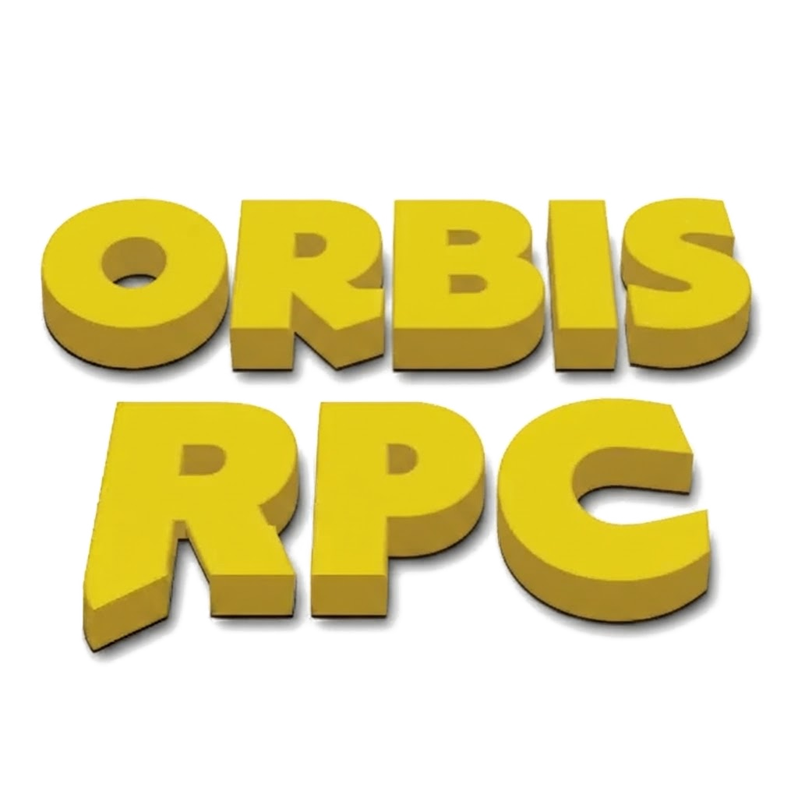

<p align="center">
  
</p>

# orbisRPC — Discord Rich Presence for PS4 (GoldHEN RPC)

<p align="center">
  <a href="https://github.com/SirHumza/orbisRPC/releases"></a>
  <a href="https://github.com/SirHumza/orbisRPC/actions/workflows/ci.yml"></a>
  
  
  <a href="https://discord.gg/BWEyfcT7ZQ"></a>
  
</p>

<p align="center">by <b>SirHumza & CyberMask367</b> · <a href="https://discord.gg/BWEyfcT7ZQ">discord.gg/BWEyfcT7ZQ</a></p>

<p align="center"><b>Discord Rich Presence for the jailbroken PS4 — every game, zero setup.</b><br>
A background daemon that lives entirely on your console and posts what you're
playing to Discord: name, cover art, timer. No PC at runtime.</p>

---

## Contents

- [What you get](#what-you-get)
- [How it works](#how-it-works)
- [Requirements](#requirements)
- [Install (5 minutes)](#install-5-minutes)
- [What you'll see](#what-youll-see)
- [Config](#config)
- [Support / Community](#support--community)
- [Troubleshooting](#troubleshooting)
- [Building](#building)
- [Developing](#developing)
- [Safety](#safety)
- [Credits](#credits)
- [License](#license)

---

## What you get

| | |
|---|---|
| 🎮 **Any game, no lists** | Names resolve from your console's metadata (SFO, app.xml) plus Sony's TMDB — CUSA, PPSA, indies, zero per-game setup. |
| 🕹️ **Homebrew + retro** | Homebrew resolves via pkg-zone; PS1/PS2/PSP classics via a custom list. |
| 🖼️ **Real cover art** | Game art served per title, PlayStation logo when idle. |
| ⏱️ **True timers** | Real elapsed time from the console clock; a reconnect never resets the clock. |
| 🧠 **Self-learning** | First-seen titles are remembered, so later boots resolve instantly. |
| 🔄 **Self-updating** | Daemon updates land from GitHub releases with automatic rollback. No reinstall treadmill. |
| 🩺 **One-file diagnostics** | Create `diagnose.request`; get a token-redacted bundle with version, uptime, close codes and the log tail. |
| 📦 **Simple install** | Payload (`.elf`) install → token → presence. |
| 👀 **Your call what shows** | `show_firmware`, `show_idle`, `show_media`, `show_homebrew` — all on by default, each toggled separately. |

## How it works

The PS4 runs one foreground app at a time, so a normal homebrew app gets
suspended the moment you launch a game. orbisRPC avoids that by running as
a **background payload daemon** while games run in the foreground.

```
PS4 (GoldHEN)                              Discord
┌─────────────────────────┐      ┌──────────────────┐
│ orbisRPC daemon         │ TLS  │  your profile    │
│  BigApp+TitleId → game  │ ◄──► │  Playing Game    │
│  metadata/TMDB → name   │      │  [cover] [timer] │
└─────────────────────────┘      └──────────────────┘
```

1. The daemon asks the OS what's in front (`BigApp` → `TitleId` — one
   call, so identity and state can't disagree).
2. Looks up its title + cover (config → app.db → local files → Sony
   TMDB → pkg-zone for homebrew → raw ID fallback).
3. Connects to the Discord gateway over TLS 1.2.
4. Sets your activity with an elapsed timer; clears it when the game exits.

Details: [`docs/DAEMON.md`](docs/DAEMON.md) · full index at [`docs/`](docs/)

## Requirements

- Jailbroken PS4 on firmware **9.00** (verified here). 13.x is
  community-reported and CI-built, not verified on this desk. GoldHEN
  running.
- A way to send the payload (elfldr on port 9021, or GoldHEN BinLoader
  on 9020).
- A Discord account + your user token (see Install).
- Internet on the PS4 that can reach Discord (see Troubleshooting if not).

## Install (5 minutes)

> ⚠️ **No PKG — beta is `.elf` only.** Use `orbisrpc.bin` (or
> `orbisrpc_sdk.elf`) from the
> **[GitHub Releases page](https://github.com/SirHumza/orbisRPC/releases)**.
> Test builds also circulate in the Discord
> (**[discord.gg/BWEyfcT7ZQ](https://discord.gg/BWEyfcT7ZQ)**,
> `testers-chat`); expect bugs and report them there.
>
> Stable = the release page. Beta = Discord `testers-chat`. Do not trust an
> `.elf` from anywhere else; release assets have a `SHA256SUMS.txt`.

1. Put the `.elf` on the console at `/data/payloads/` (FTP it over, or
   USB) — that's where GoldHEN looks for payloads. You do **not** need to
   delete an existing `/data/orbisRPC` folder; config and the learned
   cache survive updates.
2. Launch it from the payload list. First run creates the config file,
   then says there's no token yet.
3. Open `/data/orbisRPC/config.json` and add your account token in the
   `"token": "SET_ME"` slot.
4. After setting the token, re-run the payload from `/data/payloads`.
   Launch a game and watch Discord. Give feedback in `testers-chat`.
5. Optional: copy `ps1.json`, `ps2.json` and `psp.json` from the release
   into `/data/orbisRPC/` so PS1/PS2/PSP names resolve offline.

After a reboot just re-jailbreak and launch the payload from
`/data/payloads` again.

**Upgrading test builds:** replace the `.elf`; there is no need to delete
`/data/orbisRPC` or re-add your token. A new daemon process starts a new
session timer by design.

**Auto-run (not recommended on test builds):** you can drop the `.elf` in
`/data/payloads` and add it to the autorun queue in GoldHEN settings, but
test builds change fast — stick to manual runs for now.

**Install PKG (experimental, not in releases yet):** a Setup PKG exists in
the tree but is not attached to releases. On the test console it crashed
with `CE-34878-0`, and the Discord-client PKG route triggered a kernel
panic; neither is fixed. Use the payload `.elf`/`.bin` path above.

Firmware: **9.00 verified** on this desk; 13.x is community-reported and
CI-built, not verified here.

### What's in 1.1

- New game = new timer. The 10-minute continuation window and the
  cross-restart `session.json` cache are gone, so a relaunch, reboot or
  Rest Mode never shows hours the console was off.
- Rest Mode is detected from clock drift and excluded from playtime.
- `presence_hold_s` (default 300 s) keeps the closed game's tile visible
  without keeping its timer; a relaunch starts at 0:00.
- Stop the daemon by creating `/data/orbisRPC/stop`; no lock deletion or
  reboot.
- Startup log names the log path, payload launch path, GoldHEN version,
  build hash, and the exact reason a token was rejected.
- Tokens pasted with quotes or whitespace are repaired, and one bare
  token value no longer resets the rest of the config.
- PS1/PS2/PSP names resolve from local `ps1.json`/`ps2.json`/`psp.json`
  first (no DNS or nanoDNS exception needed); homebrew with no index entry
  still gets a name.
- Startup DNS probe names a broken resolver instead of retrying silently.
- Signed self-updates with verified backup and boot rollback.
- Offline name/cover cache with a bounded file and no network call on a hit.
- Token-redacted diagnostic bundle: create `diagnose.request`.
- Gateway regression replay, fragmented-message parsing, and RESUME with
  fresh-IDENTIFY fallback in the host suite.
- Config schema v2 with automatic backups; log rotation at 512 KB.
- `presence_reconcile_s` (60–3600) so a desynced tile heals itself.
- Full desktop-client fingerprint, refreshed at build time from Discord's
  stable installer and web build number (no console-side fetch).
- Eight-entry boot art cache and a 15-minute retry window, so a dead
  network cannot blank the idle tile or stall detection.

### Earlier test-build fixes

- Fixed firmware string parsing — older firmware numbers like 9.00 now
  show properly.
- Homebrew apps resolve via pkg-zone.
- Retro games (PS1/PS2/PSP) resolve via a custom list.
- Optional presence flags, all `true` by default:
  `show_firmware`, `show_idle`, `show_media`, `show_homebrew`.

## What you'll see

| Where you are | Discord shows |
|---|---|
| In a game | `Playing <Game>` + cover + elapsed timer (+ firmware line) |
| Home screen | `PlayStation 4` + logo (`Idling on Home Menu`) |
| Settings | `PlayStation 4` + `In Settings` (game timer underneath is kept) |
| Browser | `PlayStation 4` + `Using Web Browser` (game timer underneath is kept) |
| Netflix & co. | `Watching <App>` |
| Nothing to show | Presence clears |

## Config

Only `token` (your Discord user session token) is required —
`/data/orbisRPC/config.json`. Everything else ships working. Full
reference: [`docs/CONFIG.md`](docs/CONFIG.md).

| Key | Default | Meaning |
|---|---|---|
| `token` | — | Discord user session token (**required**) |
| `presence_state` | `"On PS4"` | Activity state line for games and the home screen |
| `presence_settings_text` | `"In Settings"` | Activity name while Settings is open |
| `poll_interval_s` | `12` | Detection cadence (5–300 s); heartbeats stay at ~1 s |
| `presence_hold_s` | `300` | Keep a closed game's tile visible this long (0–1800 s); the timer still ends at close |
| `home_art` | project logo | Idle tile artwork (URL or uploaded asset key) |
| `pkgzone_enabled` | `true` | Ask pkg-zone.com for homebrew names — sends the title id to a third party; set `false` to disable |
| `retro_enabled` | `true` | Resolve PS1/PS2/PSP names and covers. Ships the local index in `/data/orbisRPC/`; the remote index is only a fallback |
| `show_firmware` | `true` | Show the `Firmware X.YY` line |
| `show_idle` | `true` | Post a presence on the home screen, Settings and the browser |
| `show_media` | `true` | Post media apps (Netflix, YouTube, Plex…) as `Watching` |
| `show_homebrew` | `true` | Post homebrew titles. Retro classics are **not** affected |
| `debug` | `false` | Verbose per-poll logging |

A `false` visibility flag still detects the title — it just stops telling
Discord about it, so a game underneath keeps showing. The exception is the home
screen: with `show_idle` off, a game that closes is cleared rather than left up,
since nothing is running underneath there.

Plus the self-learned `titles` map, which fills itself in as titles resolve.

## Support / Community

Questions, test-build feedback, bug reports: join the Discord —
**[discord.gg/BWEyfcT7ZQ](https://discord.gg/BWEyfcT7ZQ)** — and post in
`testers-chat`. No need to hunt for the link; this is it.

**Found an issue?** Come to the Discord server and report it to us —
we'll take care of it.

⚠️ **This is a beta.** Test builds are handed out on the Discord — join the
server to get beta access.

## Troubleshooting

Short version here; the full symptom-first guide is
[`docs/TROUBLESHOOTING.md`](docs/TROUBLESHOOTING.md).

**Need to report a problem?** Create an empty file at
`/data/orbisRPC/diagnose.request`, wait five seconds, and fetch
`/data/orbisRPC/diagnostic.txt`. It contains the version, firmware, uptime,
recent gateway close codes and the log tail, with the token redacted.

**Game cover not showing on Discord?** It's your DNS blocker. Disable it, or use
[nanoDNS](https://github.com/drakmor/nanoDNS) with an exception.

To add the exception, open the nanoDNS config at
`/data/nanodns/nanodns.ini` and find the exceptions list:

```ini
[exceptions]
feature.api.playstation.com
.stun.playstation.net
stun..playstation.net
ena.net.playstation.net
post.net.playstation.net
gst.prod.dl.playstation.net
```

Add `tmdb.np.dl.playstation.net` so it looks like this:

```ini
[exceptions]
tmdb.np.dl.playstation.net
feature.api.playstation.com
.stun.playstation.net
stun..playstation.net
ena.net.playstation.net
post.net.playstation.net
gst.prod.dl.playstation.net
```

Once you're done, save and restart your console.

Also set your PS4's DNS to `127.0.0.1` so traffic actually goes through
nanoDNS — then reboot. (This is the step most people miss.)

**Still "can't connect to Discord" while the PS4 is online?**

1. Open the PS4 web browser and go to `discord.com` — if that doesn't load,
   it's your connection, not the payload.
2. Delete `/data/orbisRPC/log.txt`, restart the console, run the payload
   again.
3. If it still fails, send the new `log.txt` in `testers-chat`.

**Known issues (test build)**

- Some homebrew (Apollo Save Tool, Cheats Manager, Homebrew Store) isn't
  detected yet — under investigation.
- Hotspot/mobile connections can send oversized frames that Discord
  rejects — use stable Wi-Fi/LAN if presence won't set.

## Building

```bash
./scripts/build_sdk_from_source.sh   # SDK from git (REQUIRED - see note)
PS4_SDK_SRC=~/ps4-payload-sdk-src \
PS4_PAYLOAD_SDK=~/ps4-payload-sdk ./scripts/build_sdk.sh   # daemon payload
make -f installer/Makefile        # Setup PKG (OpenOrbis toolchain, llvmshim)
make -C tests test                # host unit tests
make -C tests asan                # ASan/UBSan
python3 tests/e2e_consumer.py     # contracts + linkage gate
```

⚠️ **Build the SDK from git, not the release ZIP.** The SDK's CRT refuses to
start on firmware it does not list, and terminates the payload before `main()`
with no log line. The released SDK (v0.9) lists 13.50 but not 13.52, so a
ZIP-built payload cannot boot on 13.52. See
[`docs/research/sdk-13.52.md`](docs/research/sdk-13.52.md).

Build/test/CI details: [`docs/BUILDING.md`](docs/BUILDING.md).

## Developing

- CI runs host tests, ASan, contract checks, the SDK payload build with a
  linkage gate, and uploads the `.elf` as an artifact. Tagging `v*`
  attaches it to a GitHub Release.
- Contributor notes: [`AGENTS.md`](AGENTS.md). Security notes:
  [`SECURITY.md`](SECURITY.md).
- PRs need the host suite green with outputs pasted (see the PR template).
- Daemon changes need on-console proof: log lines + firmware tested.

## Safety

- A user session token grants full account access — never share the config,
  never commit a real token. CI scans for token-shaped strings and fails.
- Token-based presence is outside Discord's supported client paths. 1.1
  no longer requests `AUTH_TOKEN_REFRESH`: that opt-in let Discord rotate
  the user token and log the desktop client out, because the daemon cannot
  update the desktop's token store. The daemon still borrows a desktop
  session, so a password change or "log out all devices" invalidates it.

## Credits

- **SirHumza** — project founder, daemon core.
- **CyberMask367** — firmware coverage to 13.52, pkg-zone homebrew,
  retro lists, presence flags, tester wrangling.
- Testers in `testers-chat` — every log file that made a fix possible.

## License

**GNU General Public License v3.0 or later (GPL-3.0-or-later).** The full
text is in [LICENSE](LICENSE); copyright, attribution, and third-party terms
are in [NOTICE](NOTICE).

This is free software: you can use, study, modify, and share it, including
commercially. If you distribute orbisRPC, a modified version, or a work
built from it, in source or as a binary, the GPL requires the complete
corresponding source to be available under GPL-3.0-or-later. Private,
internal forks are permitted and carry no conditions; we ask them to keep
the credit as a courtesy, but the GPL does not make that binding until the
work is distributed.

### Attribution and acknowledgment

Projects incorporating, redistributing, or building upon orbisRPC are
expected to visibly acknowledge the original project and its authors.

At minimum:

- Credit **SirHumza and CyberMask367**.
- Include a link to
  [the original orbisRPC repository](https://github.com/SirHumza/orbisRPC).
- Include the acknowledgment in the project's primary `README.md`.
- Do not present modified versions as official orbisRPC releases.

We encourage projects to showcase their integration through a short
description, feature demonstration, or relevant code snippet.

This attribution term is added under GPLv3 section 7(b), so it travels with
the code, including when you reuse a single source file or a substantial
snippet. Third-party components keep their own licenses; all are
GPLv3-compatible, so the copyleft guarantee is intact.

<!-- SPDX-License-Identifier: GPL-3.0-or-later -->
<!-- Copyright (C) 2026 SirHumza and CyberMask367 - see NOTICE for attribution terms. -->
